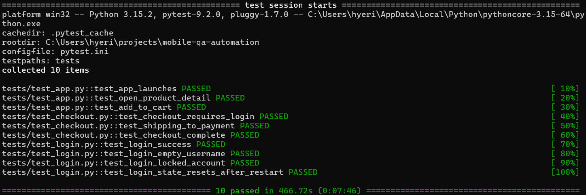

# mobile-qa-automation

Python + pytest + Appium(UiAutomator2)으로 Sauce Labs 데모 앱(Android)의 주요 사용자 흐름을 Android 에뮬레이터에서 자동화 테스트하는 프로젝트입니다.

## 기술 스택
| 구분 | 사용 기술 |
| --- | --- |
| 언어 | Python <버전> |
| 테스트 프레임워크 | pytest |
| 모바일 자동화 | Appium 2 + UiAutomator2 driver, Appium-Python-Client |
| 대기 처리 | Selenium `WebDriverWait` + `expected_conditions` (명시적 대기) |
| 테스트 대상 | Sauce Labs My Demo App (`com.saucelabs.mydemoapp.android`) |
| 실행 환경 | Windows, PowerShell, Android Emulator (`emulator-5554`) |

## 테스트 범위
| 테스트 | 검증 내용 |
| --- | --- |
| `test_app_launches` | 앱이 실행되고 현재 화면이 샘플 앱(`com.saucelabs.mydemoapp.android`)인지 확인 |
| `test_open_product_detail` | 첫 번째 상품을 눌러 상세 화면의 장바구니(Add To Cart) 버튼이 보이는지 확인 |
| `test_add_to_cart` | 상품을 장바구니에 담으면 장바구니 뱃지 숫자가 담기 전보다 1 늘어나는지 확인 |

모든 테스트는 `conftest.py`의 `driver` fixture를 사용합니다. 테스트마다 앱을 종료(`terminate_app`)했다가 다시 실행(`activate_app`)해서, 항상 첫 화면(상품 목록)에서 독립적으로 시작합니다.

## 사전 준비
1. **Android SDK / 에뮬레이터**: Android Studio에서 에뮬레이터를 만들고 실행합니다. `adb devices`에서 `emulator-5554`가 보여야 합니다.
2. **테스트 앱 설치**: 에뮬레이터에 Sauce Labs My Demo App(Android)을 설치합니다.
3. **Node.js** 설치
4. **Appium 서버와 드라이버 설치**
   ```powershell
   npm install -g appium
   appium driver install uiautomator2
   ```
5. **Python 패키지 설치**
   ```powershell
   python -m pip install -r requirements.txt
   ```

## 실행 방법
```powershell
# 1) Appium 서버 실행 (별도 PowerShell 창, 기본 주소 http://127.0.0.1:4723)
appium

# 2) 테스트 실행 (프로젝트 폴더에서)
cd C:\Users\hyeri\projects\mobile-qa-automation
python -m pytest

# 특정 테스트만 실행
python -m pytest tests/test_app.py::test_add_to_cart
```
> `pytest.ini`에 `testpaths = tests`, `addopts = -v`가 설정되어 있어서 `tests/` 폴더의 테스트가 상세 모드로 실행됩니다.
> Appium Inspector 세션이 열려 있으면 테스트 세션과 충돌하므로, 실행 전에 Inspector 세션을 닫아 주세요.

## 폴더 구조
```
mobile-qa-automation/
├── conftest.py        # driver fixture (capability 설정, 앱 재시작, 세션 종료)
├── pytest.ini         # pytest 설정 (testpaths, pythonpath, -v)
├── requirements.txt   # Python 의존성 (버전 고정)
├── tests/
│   └── test_app.py    # 앱 실행 / 상품 상세 / 장바구니 테스트
├── docs/
│   └── images/        # README용 실행 결과 이미지
├── TODO.md            # 앞으로 할 일
└── README.md
```

## 실행 결과


## 트러블슈팅
### 1. PowerShell에서 `pytest` 명령을 인식하지 못함
- **문제**: `pytest` 입력 시 "용어가 cmdlet, 함수... 의 이름으로 인식되지 않습니다" 오류
- **원인**: pytest 실행 파일이 있는 Scripts 폴더가 PATH에 등록되어 있지 않음
- **해결**: `python -m pytest`로 실행해서 현재 Python에 설치된 pytest 모듈을 직접 호출

### 2. 상품 목록 요소를 찾지 못해 `TimeoutException`
- **문제**: 상품 목록 locator로 요소를 기다리다가 10초 후 타임아웃
- **원인**: ① 추측한 resource-id가 실제 값과 달랐음 ② `noReset` 설정 때문에 이전 테스트가 끝난 화면(상세 화면 등)에서 다음 테스트가 시작됨
- **해결**: Appium Inspector와 page source로 실제 resource-id(`.../productIV`)를 확인해서 적용. `conftest.py`에서 `terminate_app` 후 `activate_app`을 호출해 매번 첫 화면에서 시작하도록 수정

### 3. 장바구니 뱃지 값이 비어 있어 `ValueError: invalid literal for int() with base 10: ''`
- **문제**: 담기 버튼 클릭 직후 뱃지 text를 `int()`로 변환하다 실패
- **원인**: 뱃지 요소는 보이지만 숫자가 아직 갱신되기 전이라 text가 빈 문자열
- **해결**: 담기 전 개수를 먼저 저장하고, 뱃지 숫자가 `담기 전 + 1`이 될 때까지 `WebDriverWait`로 기다린 뒤 검증 (빈 값은 0으로 처리)

### 4. Appium Inspector 사용 시 주의점
- **문제**: Inspector 스크린샷을 클릭해도 앱 화면이 넘어가지 않고, Inspector를 켠 채로 pytest를 실행하면 세션이 꼬임
- **원인**: 스크린샷 클릭은 앱을 조작하지 않고 요소만 선택함. Inspector도 하나의 Appium 세션을 사용함
- **해결**: 화면 이동은 Inspector의 Tap 버튼이나 에뮬레이터에서 직접 하고, pytest 실행 전에는 Inspector 세션을 닫음

## 앞으로 할 일
[TODO.md](TODO.md) 참고 — 로그인·결제 흐름 테스트, Page Object Model 리팩터링, 실패 시 스크린샷 저장, 리포트, CI 자동화, 클라우드 디바이스 팜 연동 예정
